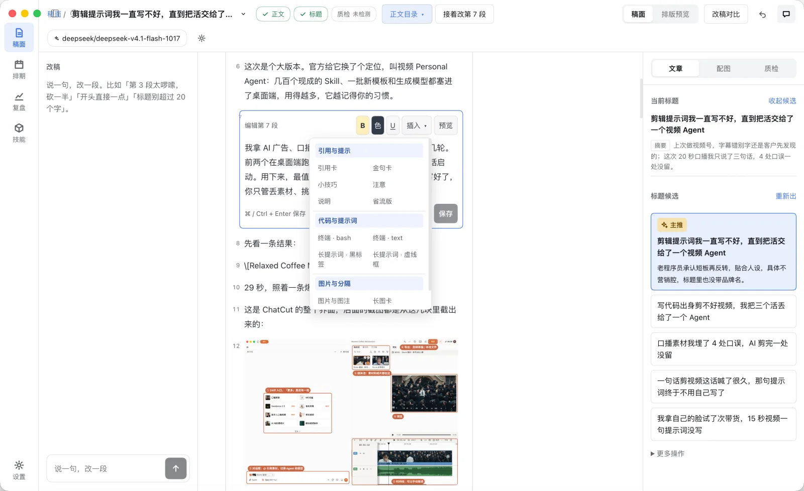
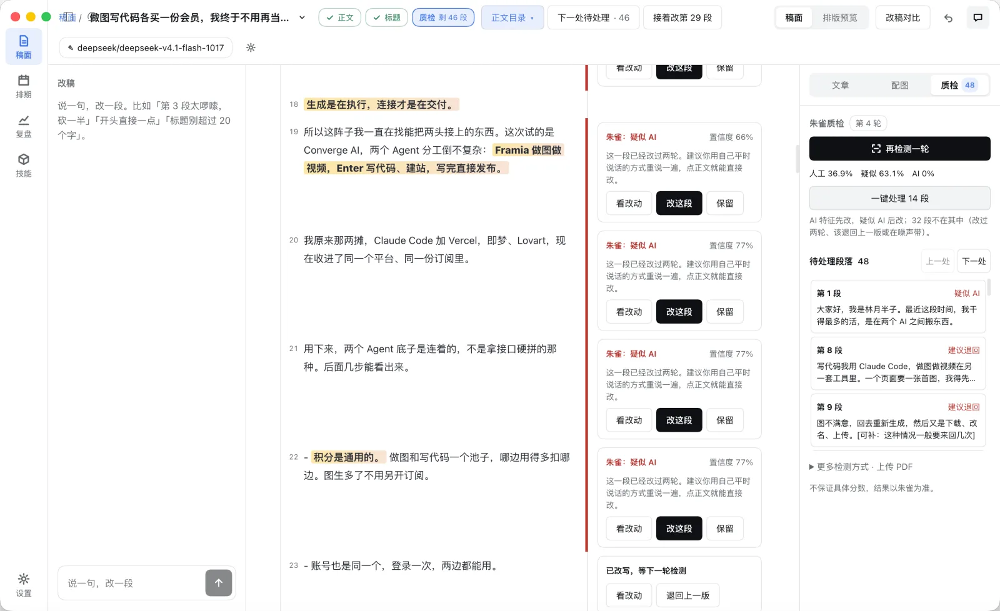
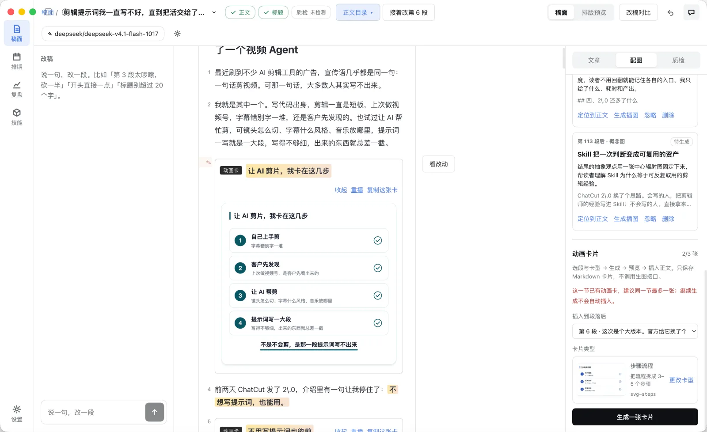
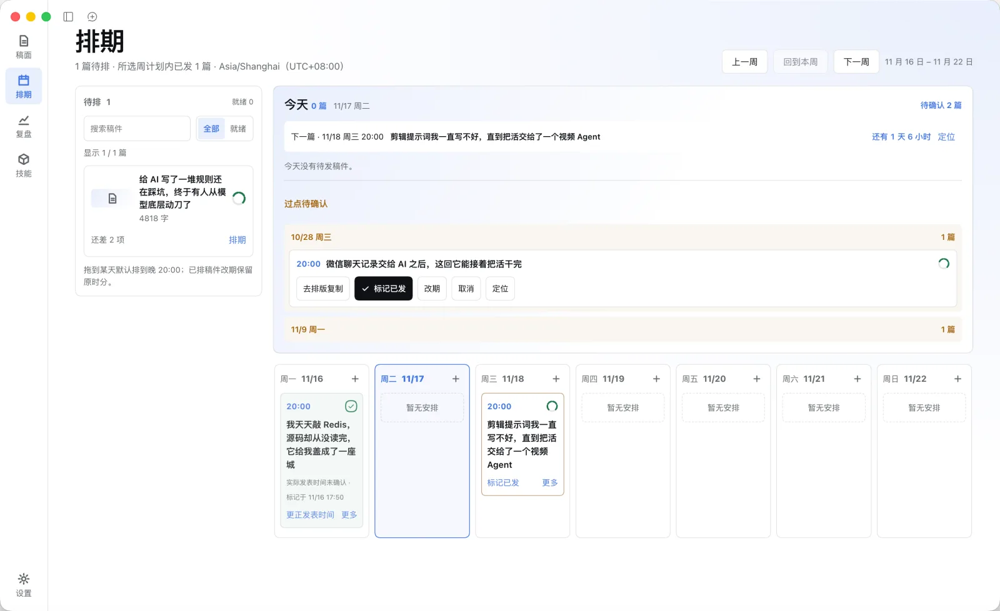
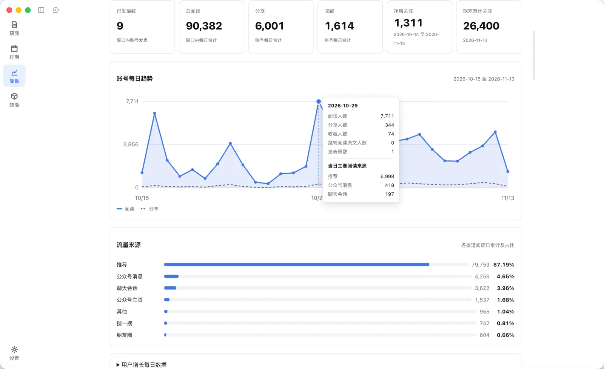
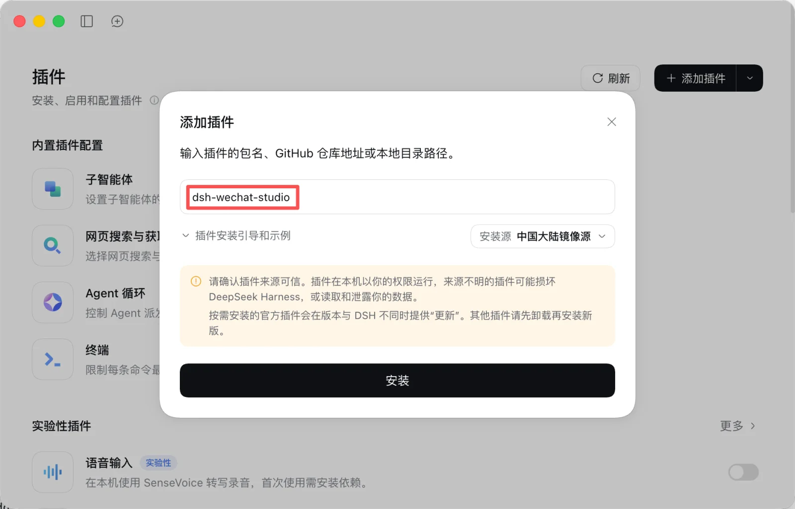

<p align="center">
  
</p>

<p align="center">
  <a href="#写作与改稿">功能展示</a> ·
  <a href="#快速开始">安装</a> ·
  <a href="#配置与数据">配置与数据</a> ·
  <a href="#开发">开发</a>
</p>

<p align="center">
  
  
  <a href="LICENSE"></a>
</p>

<br>

## 它是什么

装在 [DeepSeek Harness](https://github.com/deepseek-ai/deepseek-harness) 侧栏里的公众号工作台。导入已有 Markdown 后，按段改稿、检查文字、生成封面和正文配图，再复制成公众号可用的排版。写好的文章可以排期，发布后导入后台数据做复盘。

主要页面：**稿面 · 排期 · 复盘 · 技能**。封面、正文插图和 SVG 动画卡集中在稿面的「配图」页。

### 从写稿到复盘

<p>
  
</p>

<br>

## 写作与改稿

<table>
<tr>
<td width="62%">
  
</td>
<td valign="top">
<p><b>导入 Markdown，接着改稿。</b></p>
<p>支持已有的 .md / .markdown 稿件，导入后即可在稿面上继续编辑。</p>
<p><b>说一句，按段改。</b></p>
<p>正文可以直接编辑，也可以告诉左侧助手改哪一段、怎么改。标题候选、正文目录和插入格式都在同一张稿面上。</p>
<p><b>改错了能回头。</b></p>
<p>未保存文字会在本机暂存，支持版本对比、撤销和恢复。</p>
</td>
</tr>
</table>

<br>

## 朱雀质检

<table>
<tr>
<td valign="top" width="38%">
<p><b>检测结果落回正文。</b></p>
<p>通过 API 在线检测，或导入朱雀 PDF 报告。待处理段落会出现在纸边批注和右侧队列里，点一下就能定位。</p>
<p><b>先看改动，再决定留不留。</b></p>
<p>支持单段改写和批量处理；每处修改都能看差异、保留原文或恢复上一版。</p>
</td>
<td>
  
</td>
</tr>
</table>

<br>

## 封面与正文插图

<table>
<tr>
<td width="62%">
  
</td>
<td valign="top">
<p><b>封面可以反复挑。</b></p>
<p>六套内置风格，接通火山方舟或阿里云百炼后生成。每次结果都留在历史里，可以查看提示词、下载或重新选用。</p>
<p><b>正文插图不擅自改稿。</b></p>
<p>先分析值得配图的位置，再由你决定生成和插入。确认位置后才上传图床并写入 Markdown，生成阶段不改正文。</p>
</td>
</tr>
</table>

<br>

## SVG 动画卡

<table>
<tr>
<td valign="top" width="38%">
<p><b>把一段内容变成一张会动的卡。</b></p>
<p>概念、步骤、拆解、对比、表格、柱状图、时间线和手机演示，八种卡型都根据你选择的段落生成。</p>
<p><b>先预览，再插入。</b></p>
<p>候选标题和条目可以编辑，确认效果后才进入正文。卡片以 Markdown 保存，可原位播放、收起、重播或单独复制。</p>
<p><b>跟整篇排版保持一致。</b></p>
<p>单卡和全文共用当前风格与配色，复制结果保留 SMIL 动画。</p>
</td>
<td>
  
</td>
</tr>
</table>

<br>

## 公众号排版

<table>
<tr>
<td width="62%">
  
</td>
<td valign="top">
<p><b>选好风格，整篇一起变。</b></p>
<p>10 套正文风格、15 套配色，加上开头横幅和文末关注卡。正文插图与动画卡也会进入同一份排版。</p>
<p><b>复制后贴进公众号。</b></p>
<p>点「复制全文到公众号」即可粘贴到编辑器。自查报告会提示外部图片、视频占位等需要人工确认的项目。</p>
</td>
</tr>
</table>

<br>

## 排期发布

<table>
<tr>
<td valign="top" width="38%">
<p><b>待排、今天和这一周，分开看。</b></p>
<p>待排稿件支持搜索和就绪筛选，可以拖拽或按日期、时段排期。今日待办与过点待确认分开，周历会随窗口宽度调整。</p>
<p><b>实际发表时间单独记。</b></p>
<p>标记已发时可补记真实时间，重复确认不会覆盖首次记录，也可以更正或撤销。</p>
</td>
<td>
  
</td>
</tr>
</table>

<br>

## 数据复盘

<table>
<tr>
<td width="62%">
  
</td>
<td valign="top">
<p><b>后台数据直接进来看。</b></p>
<p>导入微信公众号后台的 XLS，查看账号趋势、用户增长、单篇明细和流量来源，不必重新整理成另一套表。</p>
<p><b>从数据走到下一篇。</b></p>
<p>按题材和标题套路比较文章表现，记录下一次要试什么。数据提炼出的写作规则，确认后可以保存为 Skill。</p>
</td>
</tr>
</table>

<br>

## 快速开始

### 安装到 DeepSeek Harness

需要 DeepSeek Harness `>=0.2.1-rc.5 <0.3.0`。排版需要 Python 3，使用 Python 标准库。封面裁切目前依赖 macOS 的 `sips`。

#### 直接安装（推荐）

在 DeepSeek Harness 的「插件」→「添加插件」中输入包名 `dsh-wechat-studio`，点击安装。

<p align="center">
  
</p>

也可以用命令行安装。桌面版：

```bash
dsh plugin --profile desktop add dsh-wechat-studio
```

网页版：

```bash
dsh plugin --profile web add dsh-wechat-studio
```

桌面版请在安装前完全退出 DeepSeek Harness，安装后重新打开；网页版安装后重启 `dsh web`。终端里没有 `dsh` 时，可先在桌面版菜单中选择「管理 dsh 命令」。安装完成后，从宿主侧栏打开「公众号成稿台」。

卸载桌面版插件可运行 `dsh plugin --profile desktop remove dsh-wechat-studio`。

#### 从源码安装

需要 Node.js 20 或更高版本。

```bash
git clone https://github.com/lqshow/dsh-wechat-studio.git
cd dsh-wechat-studio
npm ci
npm run build
dsh plugin --profile desktop add "$PWD"
```

网页版把最后一条命令中的 `desktop` 换成 `web`。

### 独立预览

在仓库目录执行 `npm ci`、`npm run build` 和 `npm run dev`，然后打开 [本地预览](http://127.0.0.1:4173)。预览使用模拟宿主和固定的模型回复，数据保存在仓库的 `.dev/` 下。

## 复盘数据说明

在「复盘」中导入微信公众号后台导出的 `.xls` 文件。三类数据可独立查看。

| 导出类型 | 可以查看的内容 |
| --- | --- |
| 数据趋势 | 账号每日阅读与分享、渠道来源、单篇在统计窗口内的阅读人数与占比。 |
| 用户增长 | 每日新关注、取消关注和净增，以及期末累计关注。 |
| 单篇数据明细 | 阅读趋势、渠道、受众分布，以及消息打开比例、完读、停留、分享和新增关注等诊断指标。 |

关联趋势卡片后，可以从对应文章打开单篇明细。关联稿件后，复盘还能引用稿面的封面、标题套路和排版记录。给同类文章标记相同题材后，成绩单可比较发表首日或前 7 天表现，并把符合条件的文章放入「本期值得看的文章」。

可以从成绩单记录「下一篇试什么」，再关联下一篇稿件。新稿明细导入并关联后，可比较两篇发表后 7 天的表现并记录结论。由数据生成的 Skill 规则提供预览，确认后才写入本地覆盖目录。

阅读人数以对应导出表的统计口径为准。按天累计的指标可能重复计入跨天读者。「近 7 天 / 近 30 天」筛选的是文章发表日期，账号趋势和用户增长各自使用导出表的统计窗口。

## 配置与数据

### 按需配置服务

插件采用 MIT 许可证。模型、检测、生图和图床服务使用你自己的账号及额度，费用按各服务商规则计算。

| 服务 | 用途 | 配置入口 |
| --- | --- | --- |
| DeepSeek Harness 模型 | 写稿、改稿、标题、横幅、封面提示词、正文插图建议和 SVG 动画卡内容 | 在宿主配置模型，然后在插件里选择。 |
| 朱雀 API | 在线检测正文 | 在 EdgeOne Makers 的 Models → API Key 创建密钥，在插件「设置 → 朱雀质检」测试并保存。也可直接上传报告 PDF。 |
| 火山方舟 | 生成封面图和正文插图（Doubao Seedream） | 在「设置 → 封面生成」选择提供方为火山方舟，填写 API Key 并选择生图模型。 |
| 阿里云百炼 | 生成封面图和正文插图（通义万相 / 千问图像，仅 PNG） | 在「设置 → 封面生成」选择阿里云百炼，填写中国内地（北京）的 API Key 并选择生图模型。 |
| Cloudinary | 转存飞书图片，并在确认插入正文插图时取得可发表的 HTTPS 地址 | 在「设置 → 图片图床」填写 Cloud Name、API Key 和 API Secret。 |

导入飞书 Markdown 后，图片会在后台转存，成功后正文使用 Cloudinary 的可访问地址。如果失败，可以在稿面重试。飞书链接过期时，请重新从飞书复制 Markdown。

朱雀 API 的置信度和 PDF 报告里的 AIGC 值分别显示。API 会按原文匹配段落，手动报告的段落对应由模型辅助，以报告原文为准。重复的开头语等内容，可在设置里加入检测时排除的固定句。

### 技能与存储

插件数据默认在 `~/.dsh/wechat-studio/`。设置 `DSH_HOME` 后，根目录改为 `$DSH_HOME/wechat-studio/`。

| 文件或目录 | 用途 |
| --- | --- |
| `state.json` | 稿件、编辑历史和稿面状态 |
| `settings.json` | 插件设置和服务凭证 |
| `insights.json` | 复盘导入数据、匹配、题材和写作尝试 |
| `covers/` | 生成的封面图片 |
| `inline-images/` | 已生成但独立保存的正文插图 PNG 资产；重画、删除记录、整篇重写或删稿时清理不再引用的文件，Host 启动时在状态文件有效的前提下清理崩溃遗留的孤儿文件 |
| `skills/` | 用户覆盖技能、插图风格扩展，以及确认写入的复盘规则 |

未保存的段落文字和上次编辑位置保存在当前宿主的本地存储中。调用模型、朱雀、火山方舟、阿里云百炼或 Cloudinary 时，相应任务的数据会发送给所用服务。

可覆盖的内置技能包括 [写作](skills/writer.md)、[标题](skills/headline.md)、[去 AI 味](skills/humanizer.md)、[朱雀流程](skills/zhuque.md)和[开头横幅](skills/banner.md)。将同名文件放进数据目录的 `skills/`，下一次调用就会读取该版本。

[封面技能](skills/linyuebanzi-cover-banner/SKILL.md)从插件内置目录读取。风格模板与禁用词表位于同目录的 [references](skills/linyuebanzi-cover-banner/references/)，封面生成时会重新读取。

[正文插图技能](skills/linyuebanzi-inline-diagram/SKILL.md)保留完整目录结构，包含提示词模板、示例和全部风格文件。应用分析只读取 `references/analysis-contract.md` 并剥离 frontmatter，不执行原 skill 中的外部脚本；生图读取 `references/styles/`。将 `linyuebanzi-inline-diagram/` 放进数据目录的 `skills/` 后可以覆盖这些文件；新增符合 `小写字母-短横线.md` 命名的风格文件，就会自动出现在生成对话框中，无需修改 JavaScript。风格列表按文件变化缓存，单个文件不可读时跳过并在配图页提示，不影响其他功能。生成对话框以画廊显示原 skill 仓库的成品预览，预览图缩至 640px 宽并以内联 WebP 打包，源文件与封面一样放在 `client/assets/inline-styles/`；扩展风格没有内置预览时显示名称和回退卡片。

[SVG 动画卡技能](skills/wechat-svg-cards/SKILL.md)包含八种卡型的内容约束和示例，渲染脚本内置在插件中。动画使用 SMIL，不执行卡片中的脚本或加载外部资源。发布前请先在公众号测试草稿粘贴单卡和整篇，确认所用客户端保留动画、顺序和配色。

## 开发

```bash
npm ci
npm run build    # 构建 dist/client.js
npm run watch    # 监听客户端并重新构建
npm run dev      # 启动本地预览
npm test         # 运行自动化测试
npm pack         # 构建并打包可安装的 tgz
```

修改 `src/` 后重启宿主。测试需要 Python 3。PDF 用例是否运行取决于本机的 Chrome 和 PDF 工具。

| 目录 | 职责 |
| --- | --- |
| `client/` | 稿面、编辑器、排版预览、设置与复盘界面 |
| `src/` | Host 接口、文章流水线、模型调用、数据存储与 XLS 解析 |
| `skills/` | 随插件分发的技能和封面模板 |
| `vendor/layout/` | 微信公众号排版引擎 |
| `scripts/` | 构建和本地预览脚本 |
| `test/` | 核心逻辑和 Host 接口测试 |
| `dist/` | 宿主加载的客户端构建产物 |

Host 接口通过宿主鉴权。页面只读取凭证是否已配置，密钥由 Host 使用。模型返回的改稿操作经过白名单和段号校验。

## 许可证与致谢

本项目是社区插件，采用 [MIT 许可证](LICENSE)。

感谢 [DeepSeek Harness](https://github.com/deepseek-ai/deepseek-harness) 提供插件系统。排版引擎来自 [lqshow/wechat-article-skills](https://github.com/lqshow/wechat-article-skills)，同样采用 MIT 许可证。
